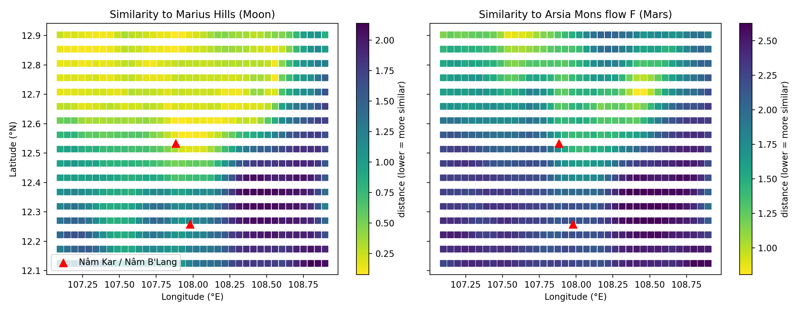

# LavaTwin: Terrain Analogs for Lunar and Martian Lava-Tube Sites

*NASA Space Apps Challenge 2026:* *Identify Earth Locations that Analog the Permanent Moon Base Locations and Mars*

**A case study in the Krong No volcanic field (Lam Dong Province, Vietnam)**

Team: SP CE - Nguyen Ngoc Thao Nguyen and Truong Ngoc Duong.

## Summary:
LavaTwin is an open-data workflow that looks for places on Earth whose terrain resembles lava-tube sites proposed for Moon and Mars bases. We compared slope and roughness from NASA and ESA elevation models for Marius Hills (Moon), an Arsia Mons lava flow (Mars), the Krong No volcanic field (Vietnam) and a non-volcanic control (Mekong Delta). Some Krong No windows closely match Marius Hills, so the area is a candidate training analog for the Moon. Mars did not match, and we report that negative result openly. Terrain similarity is not geological similarity, so the matches must still be checked against basalt geology maps.

## Research Question:
Do any parts of the Krong No volcanic field resemble lava-tube pit and skylight terrain at Marius Hills (Moon) and Arsia Mons (Mars), in terms of **slope** and **surface roughness**?

## Hypothesis:
Some Krong No terrain is closer to the Moon and Mars sites than the best-matching terrain in a **non-volcanic control region** (Mekong Delta).

## Why It Matters:
Lava tubes are candidate locations for permanent bases because they may offer natural shelter from radiation, dust and temperature swings. Places on Earth with similar terrain could let teams rehearse rover routes and lava-tube surveys closer to home and at lower cost before real missions.

## Study Sites:
Coordinates are listed in [`sites.csv`](sites.csv).

| **Body** | **Site** | **Coordinates** | **Feature type** |
|---|---|---|---|
| Earth | Krong No volcanic field (Nam Kar, Nam B'Lang, lava caves), analyzed as one region | window scan over about 12.1-12.9 N, 107.1-108.9 E | Cinder cones, lava tubes |
| Moon | Marius Hills Pit | 14.0917 N, 303.2299 E | Mare pit, lava-tube skylight candidate |
| Mars | Arsia Mons, tube-fed lava flow F | 3.2 S, 236.2 E | Lava-tube skylight candidates |
| Earth (control) | Mekong Delta | 10.5 N, 105.5 E | Non-volcanic alluvial plain |

Nam Kar (12.2586 N, 107.9793 E) and Nam B'Lang (12.533 N, 107.883 E) were merged into one "Krong No" region.

## Data Sources:
Earth: NASADEM, 1 arc-second (NASA Earthdata, LP DAAC), tiles n12e107, n12e108 and n10e105
Moon: LRO LOLA gridded DEM, LDEM_128 (NASA PDS Geosciences Node products)
Mars: MGS MOLA / MEX HRSC blended DEM, 200 m (USGS Astrogeology), read remotely without downloading the whole file
Mars site selection: Cushing (2012), candidate cave entrances north of Arsia Mons, Journal of Cave and Karst Studies (Table 1; coordinates should be verified against the paper)

## Method:
1. Download the DEMs and mosaic the two NASADEM tiles that cover Krong No.
2. Convert each DEM to meters and resample all of them to a common resolution of about 200 m.
3. Compute slope (degrees) and local roughness (standard deviation of elevation in a 3 x 3 neighborhood).
4. Whole-region comparison: extract a 50 x 50 km patch around each site and compare distributions.
5. Window scan (like-for-like): extract a 20 x 20 km patch at Marius Hills and at Arsia Mons, then slide a 20 x 20 km window (5 km stride) across the Krong No mosaic and across the control tile.
6. Score each window with the normalized Wasserstein distance between slope distributions and between roughness distributions, averaged (0 = identical, larger = more different).
7. Report the best window and the median window per region, so a single lucky window cannot drive the conclusion.

## Results:
### Terrain statistics (50 x 50 km patches):
| **Site** | **Median slope (deg)** | **Median roughness (m)** | **Relief (m)** |
|---|---|---|---|
| Krong No | 3.38 | 12.33 | 1264 |
| Control (Mekong Delta) | 0.29 | 1.15 | 28 |
| Marius Hills (Moon) | 1.26 | 4.41 | 1336 |
| Arsia Mons flow F (Mars) | 0.45 | 1.42 | 534 |

### Whole-region comparison (50 x 50 km patches, distance, lower = more similar):
| **Target** | **To Krong No** | **To control** |
|---|---|---|
| Marius Hills (Moon) | 0.692 | 0.893 |
| Arsia Mons flow F (Mars) | 1.160 | 0.511 |

### Window scan (20 x 20 km windows):
| **Target** | **Krong No best** | **Control best** | **Krong No median** | **Control median** |
|---|---|---|---|---|
| Marius Hills (Moon) | 0.066 | 0.471 | 0.861 | 0.919 |
| Arsia Mons flow F (Mars) | 0.628 | 0.284 | 1.332 | 0.729 |

Moon:the three best Krong No windows (about 12.85 N, 107.73 to 107.83 E, around 220 m elevation) closely match the slope and roughness distributions of Marius Hills and are much closer than the best control window. The median windows of the two regions are similar (0.861 versus 0.919), so only some Krong No terrain matches. These windows are lowland terrain about 35 km north of Nam B'Lang, not the volcano cones themselves.
Mars: no Krong No window matches the Arsia Mons flow closely (best 0.628). Its slopes are uniformly gentle, while even the best Krong No window has a longer tail of steeper slopes (Figure 2), and the flat Mekong Delta matches it better (0.284). The hypothesis is not supported for this Mars site.
Overall: the hypothesis is partially supported.

*Figure 1. Similarity of each 20 x 20 km Krong No window to Marius Hills (left) and Arsia Mons flow F (right). Red triangles mark Nam Kar and Nam B'Lang.*

*Figure 2. Slope distributions (20 x 20 km windows, about 200 m resolution) of each Moon/Mars site, the best Krong No window and the best control window.*

## What it means for training.
**Similar:** all three places are basaltic volcanic terrain with lava tubes or tube candidates. For the Moon, part of Krong No reproduces the slope distribution of Marius Hills.
**Different:** Krong No is humid, vegetated and weathered, while the Moon and Mars are dry and bare. Gravity is about 1/6 g on the Moon and about 0.38 g on Mars. Lunar and Martian lava tubes are expected to be much larger than Earth's.
**Possible uses:** rehearsing rover routes and slope limits on Moon-like terrain, and practicing the search, survey and mapping of lava-tube entrances. Because a flat delta also scores as "similar" to a smooth Martian lava plain, terrain metrics alone can mislead, and geology must be checked before choosing a test site.

## Limitations:
Terrain similarity is not geological similarity. The best-matching Krong No windows were not checked against basalt geology maps.
Earth, Moon and Mars differ in climate, erosion history and gravity; only terrain is compared.
Resolution is about 200 m, so individual pits and cones (for example the Nam Kar cone, roughly one pixel wide) are not resolved; the analysis is regional.
One site per body was analyzed, and the Mars site coordinates were read from Cushing (2012) Table 1 and should be verified.
Best values come from different numbers of windows (the Krong No mosaic covers two tiles, the control one), so they carry a selection effect; medians are less affected.
Distances are normalized per comparison and are not significance tests.

## Next Steps:
Check the best-matching windows against basalt geology maps of Lam Dong and Dak Nong.
Add more Moon and Mars sites, and a second non-volcanic hilly control.
Use higher-resolution data to compare pit-scale and cone-scale morphology.

## Reproducibility:
The analysis was run in Google Colab; the notebook is in [`notebooks/analog_krongno.ipynb`](notebooks/analog_krongno.ipynb). DEM files are not stored in this repository and must be downloaded from the sources above.
Processing notes: the LOLA LDEM_128 file is in a meter-based simple cylindrical projection (central meridian 180 degrees, raw values scaled by 0.5 m), and the Mars blended DEM uses longitudes from -180 to 180 degrees. The code converts both to a common frame. Mean radii used: Earth 6371000 m, Moon 1737400 m, Mars 3396190 m.
