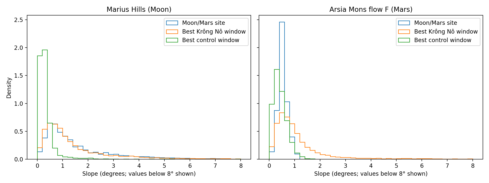

# Terrain Analogs for Lunar and Martian Lava-Tube Sites

**NASA Space Apps Challenge 2026:** Identify Earth Locations that Analog the Permanent Moon Base Locations and Mars.

A case study in the Krong No volcanic field (Lam Dong Province, Vietnam)

## Research Question:
Do any parts of the Krong No volcanic field resemble lava-tube pit and skylight terrain at Marius Hills (Moon) and Arsia Mons (Mars), in terms of slope and surface roughness?

## Hypothesis:
Some Krông Nô terrain is closer to the Moon/Mars sites than the best-matching terrain in a non-volcanic control region (Mekong Delta).

## Why It Matters:
Lava tubes are candidate locations for permanent bases because they may offer natural shelter. A terrain analog on Earth could support rover testing and lava-tube survey practice.

## Study Sites:
Coordinates are listed in [`sites.csv`](sites.csv).

| **Body** | **Site** | **Feature type** |
|---|---|---|
| Earth | Krong No (Nam Kar, Nam B'Lang, lava caves) | Cinder cones, lava tubes |
| Moon | Marius Hills Pit | Mare pit / lava-tube skylight candidate |
| Mars | Arsia Mons, tube-fed flow F | Lava-tube skylight candidates |
| Earth (control) | Mekong Delta | Non-volcanic alluvial plain |

## Data Sources:
- Earth: NASADEM (NASA Earthdata, LP DAAC).
- Moon: LRO LOLA gridded DEM, LDEM_128 (PDS Geosciences Node).
- Mars: MGS MOLA / MEX HRSC blended DEM, 200 m (USGS Astrogeology).
- Mars site selection: Cushing (2012), Candidate cave entrances on Mars, Journal of Cave and Karst Studies.

## Method:
1. Resample all DEMs to a common resolution (about 200 m).
2. Compute slope (degrees) and local roughnes (3 x 3 elevation standard deviation).
3. Extract a 20 x 20 km patch around each Moon/Mars site.
4. Slide a 20 x 20 km window (5 km stride) across Krong No and across the control tile.
5. Measure similarity as the mean normalized Wasserstein distance between slope and roughness distributions (lower = more similar).

## Results:
| **Target** | **Krong No best** | **Control best** | **Krong No median** | **Control median** |
|---|---|---|---|---|
| Marius Hills (Moon) | 0.066 | 0.471 | 0.861 | 0.919 |
| Arsia Mons flow F (Mars) | 0.628 | 0.284 | 1.332 | 0.729 |

Moon: the best Krong No windows (about 12.85°N, 107.73 to 107.83°E, around 220 m elevation) closely match Marius Hills and are much closer than the best control window. The median windows of the two regions are similar, so only some Krong No terrain matches.

Mars: the Arsia Mons lava plain is smoother than any Krong No window, and the flat Mekong Delta matches it better. The hypothesis is not supported for this Mars site.

**Overall:** the hypothesis is partially supported.

*Figure 2. Slope distributions (20 x 20 km windows, about 200 m resolution) of each Moon/Mars site, the best Krông Nô window and the best control window.*

## Limitations:
- Terrain similarity is not geological similarity. The best-matching Krong No windows are low, gently sloping terrain and were not checked against basalt geology maps.
- Earth, Moon and Mars differ in climate, erosion history and gravity; only terrain is compared.
- DEM resolution (about 200 m) cannot resolve individual pits; the analysis is regional.
- One site per body was analyzed. The "best" values come from different numbers of windows (more in Krong No than in the control tile), so they carry a selection effect; medians are less affected.
- Distances are normalized per comparison and are not significance tests.
- Earth lava tubes are generally smaller than those inferred on the Moon and Mars, so the analog applies to feature type, not scale.

## Next Steps:
- Check the best-matching windows against basalt geology maps of Lâm Đồng and Đắk Nông.
- Add more Moon and Mars sites, and a second non-volcanic hilly control.
- Use higher-resolution data to compare pit-scale morphology.

## Reproducibility:
The analysis notebook is in [`notebooks/analog_krongno.ipynb`](notebooks/analog_krongno.ipynb). DEM files are not stored in this repository and are downloaded from the sources above.

## Author: Nguyen Ngoc Thao Nguyen, Truong Ngoc Duong, SP CE, NASA Space Apps Challenge 2026.
